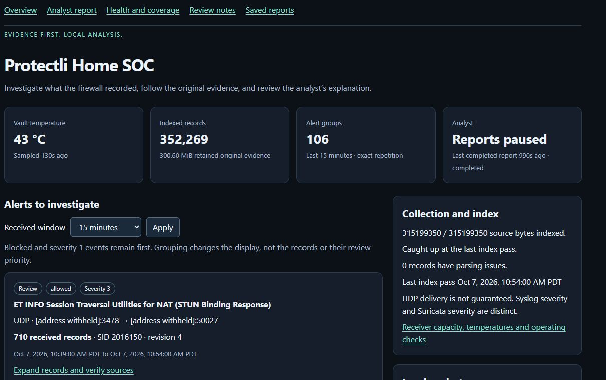

# Protectli Home SOC

I built a Home SOC around a Protectli Vault, tested what its firewall actually detected and blocked, then added a local analyst that links its explanations back to the original evidence.

The Vault runs OPNsense and Suricata. An owned Windows host receives the logs, serves a model-independent evidence overview and runs optional local reports. Start with an original record and a working collection path; the model is an additional reporting step.

Protectli provided the V1610 for this project. The testing and opinions are my own.

## The traffic and evidence path

```text
Authorized upstream Ethernet
            |
    V1610 Port 2 / WAN
    OPNsense + Suricata
    V1610 Port 1 / LAN
            |
      Owned Windows client
            |
  UDP logs -> original JSONL segments -> derived SQLite index + overview
                                       -> deterministic brief
                                       -> optional local model + validator
                                       -> saved reports + private review notes
```

The Vault routes and inspects. The client stores and reviews events. The model runs on the client, receives a bounded fact brief and has no tool or firewall-policy control. Existing Wi-Fi, same-LAN traffic that never crosses the inspection point, and HTTPS/VPN payload inspection are outside this proof.

## Requirements and first successful run

The tested host uses Python 3.12 and PowerShell 7.6.5. Evidence browsing uses the Python standard library and needs no model. Optional inference uses a separately installed Ollama and the current 16 GiB spare-memory guard. The collector host stays on and reachable for live receipt; the Vault continues enforcing its own rules if that host stops.

Follow [First working Home SOC](docs/QUICKSTART.md): prerequisites and wiring, receive logs, open the overview, verify an original record, activate retention, optionally add CPU/GPU reports, then configure sign-in recovery. It includes actual helper parameters and ownership checks, rather than sending you between several historical setup guides.



The overview shows repeated records together and opens their original sources. This saved screenshot was taken while model reporting was paused; it is an example of evidence browsing independently of inference.

The first-run check is new Vault receipt, a caught-up index and an original source link whose complete hash verifies. A listening socket or an accepted model answer alone does not pass that check.

## Start here

| If you want to… | Read |
| --- | --- |
| Get a first successful run through one current path | [Quickstart](docs/QUICKSTART.md) |
| Wire and configure an owned lab | [Build guide](docs/BUILD_GUIDE.md) and [settings checklist](examples/opnsense-profile.json) |
| Check what actually passed | [Claim ledger](docs/CLAIM_LEDGER.md) and [performance methods/results](docs/PERFORMANCE_RESULTS.md) |
| Receive logs and review original events | The receiver instructions below, then [operator workflow](docs/OPERATOR_WORKFLOW.md) |
| Try a deterministic brief or the optional model | [Analyst guide](docs/AI_ANALYST_GUIDE.md) |
| Recover after sign-in and preserve older evidence | [Startup/restart](docs/STARTUP_AND_RESTART.md) and [retention/observation](docs/RETENTION_ARCHIVAL_AND_OBSERVATION.md) |
| Inspect the historical model studies | [First comparison](docs/MODEL_COMPARISON_RESULTS.md) and [equal-development/new-case study](docs/MODEL_REFINEMENT_RESULTS.md) |
| Review the completed 200-request model phase | [Expanded structured and written results](docs/MODEL_COMPARISON_EXPANDED_RESULTS.md) |
| Verify saved expanded study receipts offline | [Model-study verifier](docs/MODEL_STUDY_VERIFICATION.md) |
| Inspect the selectable Qwen/Gemma/Ling workbench and harder decisions | [Follow-up results and offline verification](docs/AI_FOLLOWUP_RESULTS_AND_VERIFICATION.md) |

The activated rolling policy uses **1 GiB hot originals**, **4 GiB compressed cold storage** and seven days from segment sealing, shortened visibly when capacity requires it. The original setup baseline and saved investigation records have separate preservation paths. Legacy checkpoint archives remain private; new managed checkpoints verify sources instead of repeatedly copying the whole history. See [live retention and its verified migration](docs/LIVE_ROLLING_RETENTION_2026-10-07.md) and [how this build differs from TriageWall](docs/RELATED_WORK_AND_DIFFERENCES.md).

## Tested setup and results

The V1610 has an Intel Pentium Silver N6005 (four cores), fixed 16 GB RAM, Kingston NV3 1 TB NVMe and Dasharo/coreboot+UEFI 0.9.3. Tests finished on OPNsense 26.7.5-amd64, FreeBSD 15.1-RELEASE-p3, OpenSSL 3.5.9 and Suricata 8.0.7_1. The Windows tools were exercised with Python 3.12 and PowerShell 7.6.5; optional inference used Ollama 0.35.1 on the Minisforum. Other host performance is untested.

| Check | Recorded result | Boundary |
| --- | --- | --- |
| Thermal widget and guarded CPU load | Layout survived maintenance reboots; 180-second load peaked at 62 °C, ended at 52–53 °C and cooled to 47 °C | Short workload, not a thermal soak; dashboard CPU-percentage discrepancy unresolved |
| Harmless SID 2100498 | Exact allowed HTTP 200/39-byte response, selected inline block with no body and ten-second timeout, then allowed recovery | Client outcome and original EVE matched; no malware execution |
| Benign controls | Certificate-validated HTTPS and direct Vault DNS passed during the selected block | Owned IPv4 path only |
| Installed rule snapshot | 37,125 total: 37,121 alert and four selected Critical TLS-C2 drop rules; native configuration test exit 0 | Feed counts can change; fixture returned to alert |
| Routed Internet observations | Three 25 MB downloads per mode: IDS median 537.017 Mbps, IPS median 493.027 Mbps | Includes connection/TLS and upstream variation; not isolated inspection overhead |
| LAN endpoint observations | Approximately 2370 Mbps in PCAP and 828–849 Mbps in Netmap | Traffic terminates on the Vault; not a forwarding-capacity benchmark |
| Restart and storage | Actual Vault/Windows restarts; automatic recovery after sign-in; source offsets preserved across append-only rollover; private archive citations/notes restored | User-session recovery, possible UDP gaps, no full OS/model disaster restore |

PCAP capture drops and later Netmap stream-error discards remain in [the results](docs/PERFORMANCE_RESULTS.md), with their counter boundaries and unresolved causes. The 2.5 Gbps negotiated LAN link is not an achieved forwarding result. SSH was disabled, WAN management closed, GUI listeners scoped to LAN and HostWatch discovery scoped to the owned LAN.

## Receive the Vault's logs

First verify your physical/interface map and an owned routed client using the [build guide](docs/BUILD_GUIDE.md). Supply your actual private addresses and installed Python executable; the placeholders below are not runnable addresses.

```powershell
.\tools\Start-SocReceiver.ps1 `
  -LanAddress '<owned-client-LAN-IP>' `
  -VaultAddress '<Vault-LAN-IP>' `
  -PythonPath '<Python-3.12-executable>'
```

Open `http://127.0.0.1:8765/`. Configure OPNsense remote logging for selected system/firewall/Suricata applications, RFC5424, to the owned client's UDP 5514. Keep the appliance's local logs. If Windows needs a firewall rule, [Allow-SocSyslog.ps1](tools/Allow-SocSyslog.ps1) scopes it to the explicit program, interface, addresses and port from an elevated shell.

The source-IP filter is not authentication, and UDP can lose records. The receiver preserves messages under the logical `private/logs/syslog.jsonl` path and monotonic segment offsets. The original legacy mode stops at the aggregate cap; the activated version-2 policy rolls at 32 MiB, verifies cold archives before reclaiming hot copies and expires ordinary unpinned segments within bounded storage. Starting the receiver alone does not migrate a legacy manifest. [The activation record](docs/LIVE_ROLLING_RETENTION_2026-10-07.md) describes the coordinated maintenance and preserved baseline. Separate recent general and alert views each hold 500 records; restart reads a bounded 2 MiB tail. Retained original records stay retrievable; expired unpreserved sources return an explicit expired-evidence response.

## Use the analyst with or without a model

For one deterministic snapshot, choose a new private output directory and a private alias-key path:

```powershell
py -3.12 tools/soc_analyst.py `
  --log '<absolute-logical-syslog-jsonl-path>' `
  --client '<owned-client-LAN-IP>' `
  --salt-file '<private-alias-key-path>' `
  --output '<new-private-snapshot-directory>' `
  --no-model
```

Counts, priorities, eligible explanations and source hashes come from code. With inference enabled, the model selects from that code-defined set. An independent validator rejects incorrect values, unsupported choices, invented citations and capped or incomplete responses. No additional detection or investigation-time saving is established.

The [analyst guide](docs/AI_ANALYST_GUIDE.md) sets up the separate model store and loopback API on 11435, leaving another project's default runtime alone. Model weights are not bundled. The selected default is `qwen3.5:4b`, Q4_K_M, with this recorded digest:

```text
d8b0f5e9760cd1682034f292d7ef72ec46f432149be0df7574bf2d6e92e38c04
```

The historical CPU studies used two CPU threads, zero GPU memory in the inspected runner, one request at a time, 4096 context, a 700-token ceiling, temperature 0, seed 17, thinking off, keepalive 0 and a 120-second deadline. Windows preflight requires 16 GiB spare memory. The common profile explicitly sets top_k 20, top_p 1, min_p 0, repeat_penalty 1 and both presence/frequency penalties 0. Model and profile are recorded through the CLI, worker, launcher and sign-in recovery.

The review UI on `http://127.0.0.1:8766/` now opens a model-independent SQLite overview with exact repetition groups, expandable members, fixed-window pagination and original-source links. It also provides full-tuple flow review, saved reports, hash-bound operator notes and timestamped health. Missing pre-NAT PF evidence stays unknown. Notes do not suppress alerts or enter model input. A quiet report is not an all-clear.

The earlier small comparisons remain in the historical study documents. All 200/168/48 scheduled outcomes are complete, with source-bound actual-answer reviews and exact-repeat provenance. The [expanded results](docs/MODEL_COMPARISON_EXPANDED_RESULTS.md) explain the selected Qwen3.5 4B/common profile, timely delivery, specific context and factual defects. Exact model inputs, responses and failures are included in model-evidence with a declared public subset manifest. No weights were trained in these reporting comparisons. The selected profile produced a fresh validated live report; the retained operating observations and interruptions are reviewed separately.

## SQLite, GPU and automated investigation checks

The [deployment guide](docs/SQLITE_GPU_AND_DEPLOYMENT_2026-10-06.md) describes the new derived index, dashboard, conservative grouping and opt-in Vulkan runtime. Original JSONL remains authoritative. Missing context stays separate; grouping does not suppress alerts. Source views verify complete record hashes. Index, health and browsing do not wait for inference.

The reference build still uses the Vault and one Windows analysis host. No SBC or remote inference queue is required or currently deployed. The collector host must stay reachable for live receipt. An optional SBC split is future work; phone access also remains unenabled.

The separate GPU runtime uses loopback port 11436 and the SOC-only model store. Actual Radeon 8060S logs record all 33 layers of Qwen3.5 4B offloaded. One live report returned 309 tokens in 20.781 seconds and passed the validator, with limited generic follow-up still present. That is acceptance of a working GPU path, not a matched speed or accuracy comparison. The CPU fallback and all 416 historical outcomes remain unchanged.

The [automated evaluation protocol](docs/AUTOMATED_INVESTIGATION_EVALUATION_2026-10-06.md) separates bounded model investigation decisions, different-model review and independent evidence scoring. It uses historical exposed cases, not an unseen holdout or human-usability study. Failures are retained and reviewer opinions cannot change the oracle. The [executed results](docs/AUTOMATED_INVESTIGATION_RESULTS_2026-10-06.md) retain all 56 outcomes: eight constrained reports validated, zero of eighteen measured investigator answers passed, and all twenty-four 9B reviews capped and were withheld. This broader investigator/reviewer workflow is not deployed in the live analyst.

## October 7 resource and investigation results

[Verify all 240 saved requests offline](docs/OCTOBER7_EVIDENCE_VERIFICATION.md). [Model identity and selection](docs/MODEL_IDENTITY_AND_SELECTION.md) explains Qwen versus Gemma and why the current 4B deployment is not a general model-winner claim.

The separate CPU retest used 16 threads, 8,192 context and a 2,048-token answer allowance. All 72 requests stopped naturally with verified full input; strict structured utility was 2/12, 5/12, 3/12 and 9/12 for the original 4B, newer 4B, 9B and Gemma 12B. The agent content review materially rejected 4/6, 5/6, 3/6 and 3/6 written answers respectively. Completion did not make their prose trustworthy. Several resource settings changed together, and the tasks had been exposed before. Historical settings and live constrained reporting are unchanged.

The fresh experiment completed 168 requests: 24 analyst preparations, 72 investigations and 72 supplementary reviews. Eighteen distinct measured cases in A/B/C produced 52/54 accepted investigations; the six practice cases remain outside that denominator. Both assisted failures mistyped an original reference by one character, and the reviewer missed them. All earlier failures and the interrupted checkpoint write remain preserved. Only the never-requested final pack continued, without retries.

The first actual operator pilot completed practice and six measured cases. It found every supplied block and valid supporting records, but also exposed sensor allowance being interpreted as client success and repetitive STUN lists that remained tedious. [The pilot summary](docs/HUMAN_PILOT_SUMMARY_2026-10-07.md) records limits without distributing the participant's private answers. These results do not demonstrate improved human accuracy or speed.

## Selectable models and harder next-check decisions

I added an isolated workbench after the operator pilot exposed sensor allowance being mistaken for client success. Code supplies the facts and original citations; the selected Qwen, Gemma or Ling artifact chooses a useful read-only check from the supplied menu. All five passed the same three development cases, 15/15. Selecting a model displays its retained result and leaves the scheduled reporter unchanged.

The broader six-decision task was harder. Gemma passed 8/12 on the first constructed pack; on a separate revised pack, Qwen3 4B had the highest common non-thinking score at 4/12, followed by Gemma at 3/12. Revised Ling reasoning passed 3/12, with client outcomes and references each correct on 11/12. A separately tested timestamp correction raises only those two sensitivity totals to 12/12; its strict full-answer score stays 3/12. The original Ling 0/12 and memory-guard stop remain preserved. These are task/profile results, not a family ranking or demonstrated human benefit.

The [follow-up guide](docs/AI_FOLLOWUP_RESULTS_AND_VERIFICATION.md) explains each contract and exports all 219 requests, synthetic sources, raw answers, scoring and runtime traces. Verify them locally without loading a model:

```powershell
py -3.12 -B tools/verify_ai_followup_evidence.py --root ai-followup-evidence
```

The workbench remains an experimental saved-result demonstration. It has not replaced the main dashboard or the Qwen3.5 4B/common Vulkan reporter. Live receipt adaptation, scoped check execution and a controlled human-benefit study remain future work.

## Recovery, capacity and verification

The optional recovery task checks only recorded owned components at Windows sign-in and every five minutes. It renews finite 288-start batches while signed in, stores no password and refuses conflicting owners. Native USB collection needs an authenticated console after a Vault reboot. Use [the restart guide](docs/STARTUP_AND_RESTART.md), including its pause procedure, before maintaining those components.

Before the rolling migration, verified private checkpoint archives preserved source links and pinned notes but did not reclaim the live cap. They remain historical evidence. The current managed policy archives sealed originals once, verifies their bytes, preserves new review-note citations under a separate 64 MiB/4,096-record budget, and verifies source integrity at each bounded checkpoint. The operating review retains gaps, failures, report freshness, temperatures and capacity. Its original fixed-duration observation remains historical, with no continuous-uptime claim. Same-disk archives and ZFS boot environments are not protection against losing the host or SSD. Keep private off-device configuration backups.

Run the software regression suite without a Vault or model:

```powershell
py -3.12 -m unittest discover -s tools -p 'test_*.py' -v
```

The software checks cover ingestion, grounding, source/flow/notes, simulated thermal refusal/cleanup, archive restoration, retention, operational scheduling and offline model-study verification. They do not replace [the owned-device protocol](docs/TEST_PROTOCOL.md). The GitHub workflow repeats software tests and PowerShell syntax checks on a hosted Windows runner; it does not contact a Vault or model.

## Evidence, contribution and attribution

The `examples/` files are reviewed derivatives. Replaced addresses and correlation identifiers prevent them from independently proving the private exact-flow matches. Live raw logs, configuration XML, packet captures, original private screenshots, endpoint receipts, model weights and private correspondence are excluded because they expose security/account material or network details. The reviewed illustrative screenshot is included. The complete [October 7 study derivative](docs/OCTOBER7_EVIDENCE_VERIFICATION.md) includes exact submitted inputs and answers, constructed sources and declared runtime path redactions. The reviewed [AI follow-up derivative](docs/AI_FOLLOWUP_RESULTS_AND_VERIFICATION.md) adds all 219 saved requests with declared path redactions and exclusions. This repository is private for review, and public release is pending. The first article has been submitted for partner review; the second analyst article remains in development. The [later targeted-check and small-model training summary](docs/AI_TARGETED_CHECK_AND_LORA_SUMMARY_2026-10-11.md) is separate from the unchanged 219-request export and still needs its own reviewed raw-evidence export. The current code/media terms are selected, while the release itself is still pending.

Read [contributing](CONTRIBUTING.md) before submitting a reproduction and [security boundaries](SECURITY.md) before using or reporting an issue. Original code and textual software documentation use [MIT](LICENSE), with retained copyright and permission notices. [Project media](LICENSE_MEDIA.txt) requires attribution to Trevor Unland (unland.dev) and a repository link for noncommercial sharing; commercial media reuse requires permission. These are separate grants, matching the Marauder arrangement. Public code credit is appreciated; [NOTICE.md](NOTICE.md) separates project code from appliance, rule and model licenses. OPNsense, Suricata, ET Open, Ollama and the model publishers remain the sources for their own distributions and terms.

## Completed model evidence

This repository collects the build, controlled tests and analyst development from the project. Dates in a protocol or export identify that test batch or packaging step; they do not describe the total time spent building the system. [The publication/evidence plan](docs/PUBLICATION_PLAN_2026-10-07.md) separates the article, repository and Hub roles.

The [expanded comparison](docs/MODEL_COMPARISON_EXPANDED_RESULTS.md) records all 200/168/48 outcomes, actual-answer reviews, native and common profiles, and the fresh selected-model report. The [public subset](model-evidence/PUBLIC_SUBSET_PROVENANCE.json) includes exact replay inputs and failures. Selection is for this bounded workflow, with no proven added detection or investigation-time saving. Native/default results and defective prose remain visible.
