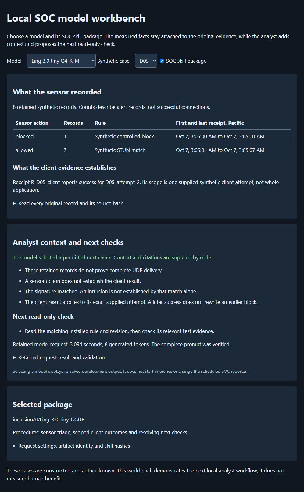

# Choosing the next check from original SOC evidence

I extended the analyst tests after the first operator pilot exposed a practical mistake: an allowed sensor event can look like successful communication even when there is no matching client result. The follow-up work separates those claims, adds selectable Qwen, Gemma and Ling results, and tests how much responsibility I can give the model before its decisions become unreliable.

The main dashboard still uses the existing Qwen3.5 4B/common Vulkan reporter. The workbench is an isolated demonstration using constructed cases and saved answers. Selecting a model displays a retained result; it does not start inference, change the scheduled reporter or execute the proposed check.



The blocked attempt remains visible beside a separate successful retry receipt. Code supplies facts and original citations, while the selected model proposes a permitted next check.

## Three different tasks

| Phase | What the model had to do | Recorded result |
| --- | --- | --- |
| Permitted next-check demonstration | Choose one check from a code-supplied useful menu; code owns context and citations | All five artifacts passed three development cases each, 15/15 |
| Harder F-pack | Select context and useful checks, match unclassified receipts and decide the client outcome, without unsupported intrusion/delivery claims | 60 requests, twelve cases per artifact; Gemma passed 8/12 strict cases |
| Revised N-pack | Same six-field decision task with a consistent revised procedure and fresh synthetic variants, including near-match receipt distractors | 60 common non-thinking requests plus twelve revised Ling reasoning requests; original Qwen3 4B passed 4/12 common cases |

The demonstration belongs to a 57-request development ledger: 24 initial comparisons, twelve refined requests, six Ling compatibility/context requests and fifteen final permitted-menu requests. One initial Ling compatibility request completed without sufficient runtime instrumentation to verify full input; it remains outside the input-verified demonstrations. The narrower 15/15 is not a repaired score for the broader task.

## Harder decisions and changing rankings

A strict pass requires all six dimensions in the same answer: context, useful checks, client outcome, exact client receipt references, no unsupported intrusion claim and no unsupported complete-delivery claim. A single extra unsupported check fails the answer. This score measures the declared policy and schema; it is not a prose-quality or general intelligence score.

| Installed artifact | F-pack strict | N-pack common strict |
| --- | ---: | ---: |
| Qwen3 4B Instruct 2507, Q4_K_M | 4/12 | 4/12 |
| Qwen3.5 4B, Q4_K_M | 4/12 | 0/12 |
| Qwen3.5 9B, Q4_K_M | 3/12 | 1/12 |
| Gemma4 12B IT QAT, Q4_0 | 8/12 | 3/12 |
| Ling-3.0-tiny, Q4_K_M | 0/12 | 0/12 |

All 132 main F/N comparison requests finished with complete input and final JSON. F and N differ in cases and prompt, so their columns are separate observations. Each common-profile comparison holds the supplied procedure, case input and answer schema equal across artifacts, but native templates, quantization and Ling's runtime differ. There is one draw per artifact/case. Timings are retained without pooling them into a speed ranking.

The two boundary dimensions test avoiding unsupported positive claims. None of these fixtures establishes an intrusion or complete UDP delivery. Correctly returning false does not establish positive intrusion-detection ability. Cases are author-known synthetic variants of exposed scenario families, not unseen real incidents. No human investigation benefit was measured.

## What changed for Ling

On the F-pack, Ling proposed `compare_retained_window` in every answer even when the case did not supply a relevant prior window. It also returned unknown for all client outcomes, including three supported results. Its 0/12 therefore records no fully correct answer, rather than twelve crashes or zero correct facts.

The inherited prompt combined an earlier two-field contract with a later six-field extension. I tested one consistent procedure separately, then enabled native reasoning and compared greedy sampling with the publisher's recommended recipe. Four development cases and the predeclared tie order selected `clean-think-long`: temperature 0, top-p 1, top-k 20, seed 17, sixteen CPU threads, 8,192 context, a 4,096-token completion ceiling and a 3,072-token reasoning cap.

On the same N-pack inputs, non-thinking Ling passed 0/12 strict cases and the selected reasoning lane passed 3/12. Client-outcome and client-reference decisions each improved from 4/12 to 11/12; context reached 7/12 and useful checks 5/12. Every enabled reasoning trace reached its cap and was forcibly closed, although final JSON stopped normally. Completion and decision accuracy stay separate.

One authored retry fixture placed collection before its event. I preserved it and separately sealed a version changing only that collection time. Six additional requests tested the correction. Replacing only that case raises revised Ling's outcome/reference sensitivity totals to 12/12 each, while strict acceptance stays 3/12. That substitution is not another independent twelve-case run.

The native batch stopped after nineteen of twenty-four planned requests at the 16 GiB spare-memory guard. A sealed continuation sent only the five never-requested bodies, with server RAM prompt caching disabled and memory monitored during each answer. None of the completed answers was retried. Resource conditions differ across that lane, and the guard stop remains in the export.

Ling's tested Windows CPU route uses the official Q4_K_M GGUF, SHA256 `246d67d45f5b0c7447ca0ce0bdb8b46b8a47b593c5068635dc16422c051d7be9`, and the pinned llama.cpp b11429 CPU release. This is Ling-3.0-tiny, not Ling Mini 2. Native Bailing chat-template and reasoning channels are retained. No weights were trained. See the [protocol](ai-followup-20261007/LING_REVISION_PROTOCOL_V1.md), [detailed results](ai-followup-20261007/LING_REVISION_RESULTS_V3.md) and [research](ai-followup-20261007/LING_REVISION_RESEARCH_V1.md).

## Verify the saved work without a model

From the repository root, using Python 3.12:

```powershell
py -3.12 -B tools/verify_ai_followup_evidence.py --root ai-followup-evidence
```

The export contains all 219 requests across development, the harder comparison, calibration, transfer and the timestamp addendum. It includes synthetic source bytes/locators, exact submitted inputs, raw answers including reasoning, original outcome grades, runtime traces, protocols, historical execution source and the selected Ling configuration. The portable verifier checks file membership/hashes, request identity, raw-answer identity, source locators, exact receipt joins, independently derived outcomes/grades, trace-based input validity, matched common workloads, retained reasoning channels and the five never-sent continuation jobs.

Local Windows path prefixes are redacted in 211 files. [The derivative manifest](../ai-followup-evidence/PUBLIC_EXPORT_MANIFEST.json) records original and public hashes for every exported file. Pre-execution seals inside the research folder refer to private originals and are retained historical receipts; their old local paths are not commands or a portable manifest. API keys, model/runtime binaries and host ownership/recovery/preflight snapshots are excluded. The credential scan found no retained key values in the selected export. The screenshot was inspected separately and contains synthetic aliases/receipts, with no identified personal or live-network information.

The frozen research launchers record the original owned-host experiments. Do not run them as installation scripts: they depend on private ownership and recovery state. The current build path remains [Quickstart](QUICKSTART.md). The public verifier is offline and uses no Vault, model endpoint or credentials. The isolated workbench has not been promoted into the main dashboard, and real-EVE receipt adaptation, scope arguments for proposed checks, repeatability and another controlled human study remain future work.

The saved closeout records ordinary Qwen3.5 4B/Vulkan recovery and a fresh successful report at October 7, 16:27:40 Pacific. Publication integration verifies those retained records; it does not take a new live health measurement or substitute a model.
